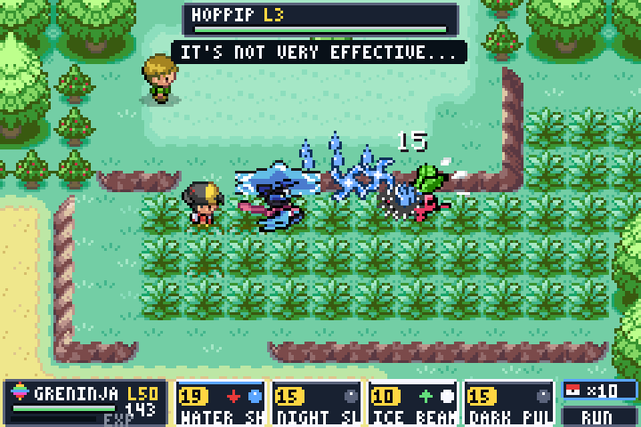
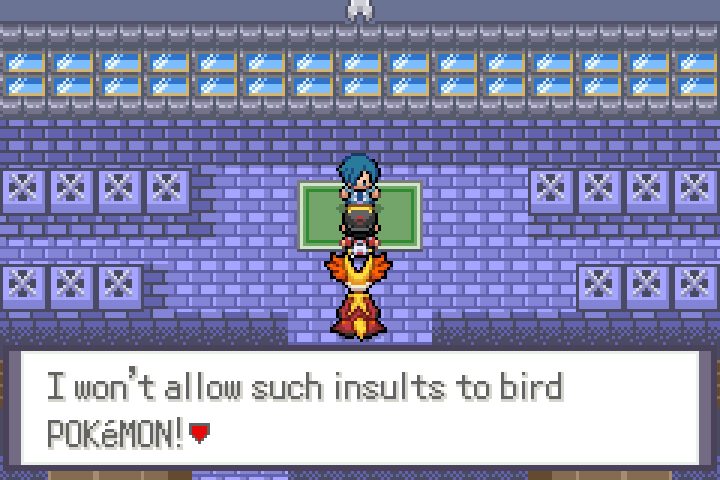
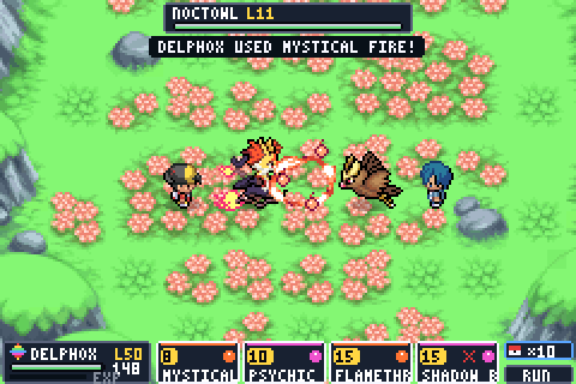
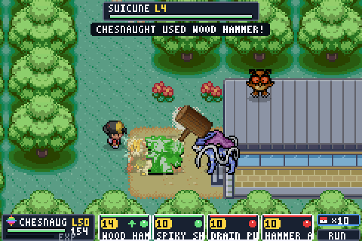
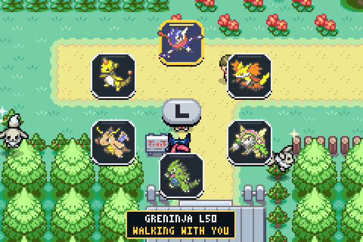
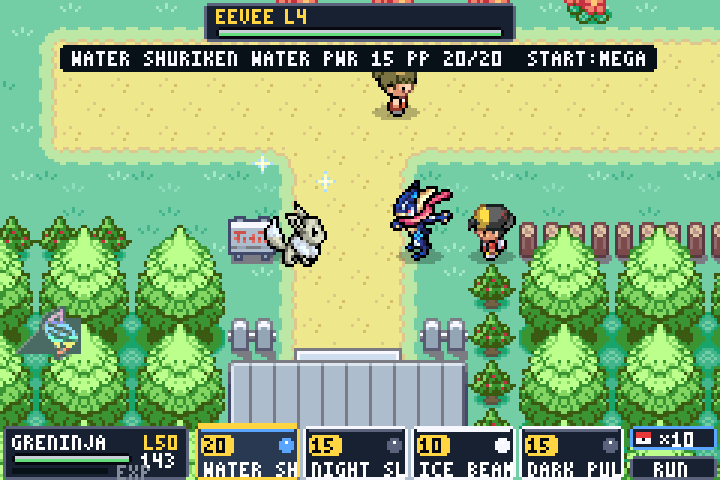

# HnS Legends

**Pokémon Heart & Soul, rebuilt with Legends Arceus / Legends Z-A style battles right on the overworld.**

*by HUY MAI*

### [⬇ Download the patch (Releases)](https://github.com/HuyMai0509/HnS-Legends/releases/latest)

- **Version:** v0.21b (early release, bugs expected)
- **Base:** Pokémon Heart & Soul 2.x (pokeemerald-expansion)
- **Patch onto:** Pokémon Emerald (USA, Europe), CRC32 `1F1C08FB`
- **Size:** 32 MB ROM (BPS patch)
- **Language:** English

---

## What is HnS Legends?

HnS Legends takes the full Johto + Kanto adventure of Pokémon Heart & Soul and removes the classic battle screen.
**Every battle now happens right on the map.** You meet a wild Pokémon in the grass, your lead Pokémon steps out
beside you, and the two fight where they stand, with move animations, damage numbers and a compact HUD drawn on
top of the overworld.

The rest of Heart & Soul is still there: the HGSS story, Kanto postgame, Gym rematches, Day/Night, following
Pokémon, the randomizer, Nuzlocke and difficulty options. HnS Legends changes how you fight, not where you go.

---

## Main features

### Overworld battles (no battle screen)
- **All battles happen on the map:** wild Pokémon, trainers, Gym Leaders, the Elite Four, legendaries, roamers,
  events, fishing, Rock Smash, Headbutt, Sweet Scent, Safari Zone and the Bug-Catching Contest.
- **Your lead Pokémon steps out** and faces the opponent. You can walk around the fight with the D-pad.
- **Gym Leaders and legendaries** fight in their own arena.
- **Animated moves on the map:** 847 moves, each with its own animation or one borrowed from a similar move and
  recoloured to the move's type.
- **Signature moves get anime-style scenes,** with effects attached to the right body part (hands, mouth, feet):
  - Starters: Water Shuriken (Greninja / Ash-Greninja), Mystical Fire, Spiky Shield, Blast Burn, Frenzy Plant, Hydro Cannon.
  - Pseudo-legendaries: Extreme Speed, Outrage, Draco Meteor, Meteor Mash, Stone Edge.
  - Legendaries: 40+ signature moves, including Psystrike, Aeroblast, Sacred Fire, Origin Pulse, Precipice Blades, V-create and Secret Sword.
- **Abilities work in overworld battles:** Intimidate, Levitate, Speed Boost, Moxie, Regenerator, Magic Bounce and
  Battle Bond, plus the rest of the weather, immunity, contact, damage and end-of-turn abilities.
- **On-screen info:**
  - Status chips for stat stages, Substitute, Leech Seed, Confusion, Taunt, Encore, screens, Tailwind, Perish Song and similar.
  - Entry hazards (Spikes, Toxic Spikes, Stealth Rock, Sticky Web) are drawn on the ground.
- **Exp. Share is always on:** the whole team earns EXP.

### Mega Evolution on the overworld
- Press **START** in battle to Mega Evolve. The Mega form appears right on the map.
- **Legends Z-A Megas:** Mega Chesnaught, Mega Delphox and Mega Greninja, in normal and shiny forms.
  - Their Mega Stones are sold on floor 5 of the Goldenrod Dept. Store.

### Kalos starters
- **Chespin, Fennekin and Froakie** are added. At Elm's lab each Poké Ball now offers a 4th choice: Johto, Kanto, Hoenn or **Kalos**.
- Elm's Froakie evolves into **Battle Bond Greninja**. It turns into **Ash-Greninja** after knocking out a foe, with its giant Water Shuriken.

### Exploring
- **Surf battles:** while surfing you still fight on the water. Pokémon that aren't Water types stand on a
  **floating platform** (Scarlet/Violet style).
- **Hidden Pokémon are visible:**
  - Headbutt Pokémon sit on top of their trees.
  - In dark caves, wild Pokémon can be seen through the darkness.
- **Eggs hatch on the map.** The egg appears in front of you, cracks, and the baby steps out. There is no hatching screen.
- **Following Pokémon everywhere.**
  - Hold **L** to open a ring and swap your lead.
  - Press **SELECT** to open the item ring (Poké Balls, berries…).

### Balance & quality of life
- **Higher shiny odds:** default **1/512**. You can choose 512, 1024, 2048, 4096 or 8192 in the options.
- **Fair early game:** wild levels are capped by your badges.
  - 0 badges: up to L10. 1 badge: L16. 2 badges: L21… 8 badges: L50.
  - Early routes only show first-stage Pokémon.
- **Game rules still apply in overworld battles:** Safari Zone, Bug Contest, roamers, Nuzlocke, level caps, Exp.
  multipliers, Amulet Coin, Pickup and the challenge modes.

---

## Controls in battle

| Button | Action |
|---|---|
| L / R | Choose a move, a Poké Ball or Run |
| A | Use the selected option |
| D-pad | Walk around the fight |
| SELECT | Switch Pokémon |
| R (item mode) | Items |
| START | Mega Evolve (when holding a Mega Stone, with the Mega Ring) |

On the overworld, press **A** next to a wild Pokémon to battle it, or throw a ball at it directly from the item ring.

---

## Features from Heart & Soul (still included)
- Gen 1–3 Pokémon plus their later evolutions, and items and abilities up to Gen 9.
- Full Johto story and Kanto postgame from HGSS, including the Kimono Girls and Eusine.
- Day/Night system, dynamic palettes, HGSS music.
- 16 Gym Leader rematches, two Safari Zones, the PokéGear with radio and rematches, all 92 HGSS TMs.
- Randomizer, Nuzlocke modes, difficulty and challenge options (level caps, EXP multiplier, party limit, one-type runs…).

---

## Not available in this version
- **Battle Frontier, Battle Tents and Trainer Hill** are closed. They relied on the old battle screen; the game tells you this instead of crashing.
- **Link battles** (cable / Union Room) end in a draw.
- Some ability messages appear in a slightly different order from the original games.

---

## How to play
1. Get a clean **Pokémon Emerald (USA, Europe)** ROM. CRC32 `1F1C08FB`.
2. Download `HnS_Legends_v0_21b.bps` from the [Releases](../../releases) page.
3. Patch it with **Floating IPS (Flips)** or **Rom Patcher JS** (online).
4. Play on mGBA (recommended) or any accurate GBA emulator.

Use a new save. Saves from Heart & Soul or older HnS Legends versions are not guaranteed to work.

---

## Screenshots
| | |
|---|---|
|  |  |
| Mega Greninja – Water Shuriken (Route 29) | Facing Falkner (Violet Gym) |
|  |  |
| Mega Delphox – Mystical Fire (Gym arena) | Mega Chesnaught vs Suicune (Ilex Forest) |
|  |  |
| Hold L: party ring (Route 36) | Shiny Eevee on the overworld (Route 36) |

---

## Bug reports
This is an early version. If you find a bug, please post:
- what happened, and where (map and what you were doing);
- a screenshot or short video;
- your save file if possible (.sav).

---

## Credits
- **Pokémon Heart & Soul** (pokemonHnS-expansion) by the Pokémon HnS development team: the base game and source.
- **pokeemerald-expansion** by **RHH (Rom Hacking Hideout)** and all its contributors; the **pret** decompilation team.
- **PMD Sprite Collab** ([sprites.pmdcollab.org](https://sprites.pmdcollab.org/)): battle poses and many follower
  sprites. All credit goes to the individual Sprite Collab artists listed on each sprite's page.
- **Pokémon Quetzal** by **Tenma** (and the artists credited by Quetzal): overworld sprites of Mega Chesnaught,
  Mega Delphox and Mega Greninja.
- Move effect frames adapted from **Pokémon Mystery Dungeon: Explorers of Sky**.
- **HnS Legends:** overworld battle system, animations and all Legends-style changes by **HUY MAI**.

If you are one of the creators above and want your work credited differently or removed, please contact me and I'll fix it right away.

---

*Pokémon is © Nintendo / Creatures Inc. / GAME FREAK inc. / The Pokémon Company. HnS Legends is a free,
non-commercial fan project. No ROMs are distributed.*
